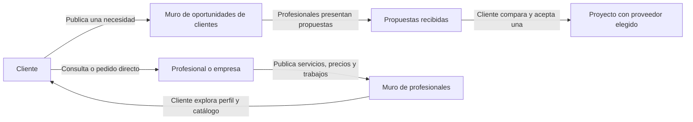
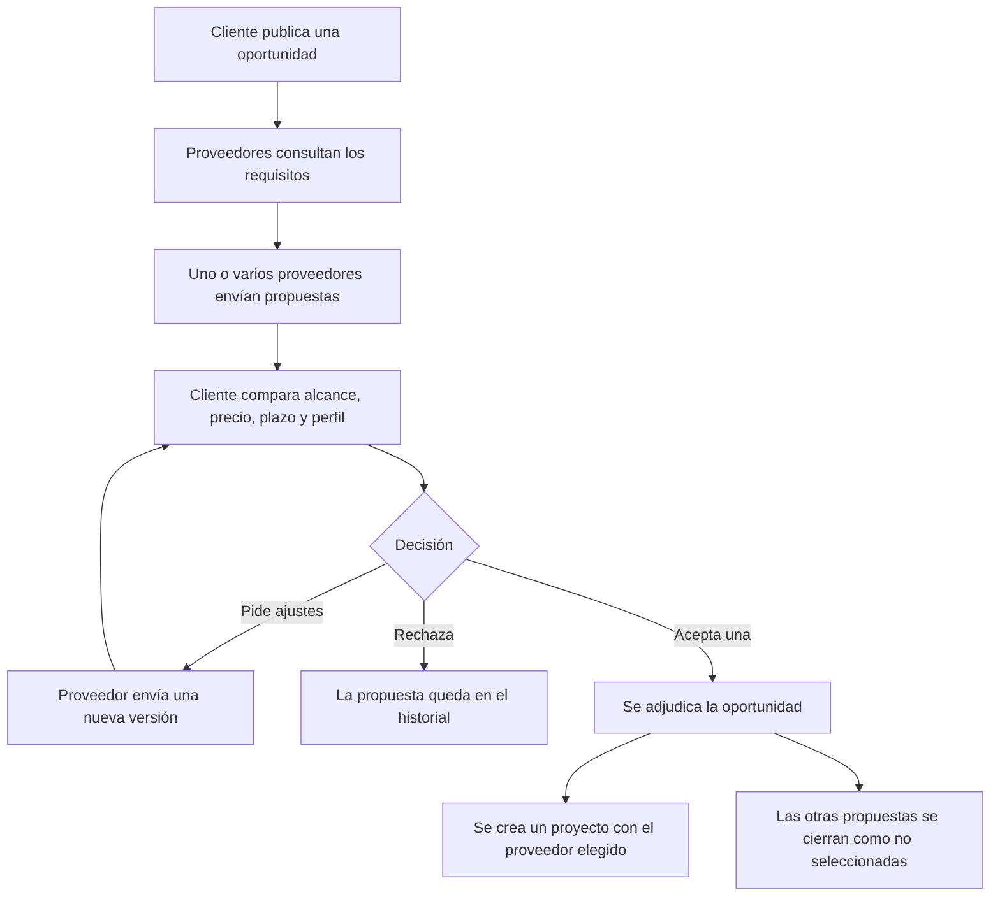

# Etapa 2 · Plataforma de empresas y profesionales

**Actualizado:** 27 de noviembre de 2026
**Estado:** planificación. Las capacidades de este documento no se consideran implementadas.

## Propósito

Registrar la evolución prevista de synaux después de entregar la primera etapa de la tesis. La etapa 2 amplía la operación de una sola organización a una plataforma donde varias empresas y profesionales ofrecen servicios y reciben oportunidades de clientes.

## Etapa 1 · Alcance de la tesis

La primera etapa se concentra en la operación de la organización principal de synaux:

- Administración de categorías, servicios, tarifas y usuarios internos.
- Estimaciones y solicitudes de clientes.
- Revisión de solicitudes y preparación de presupuestos con versiones.
- Aceptación de un presupuesto y creación del proyecto asociado.
- Asignación, pagos y seguimiento del trabajo según el recorrido definido en [Reglas del ciclo de proyecto](reglas-del-ciclo-de-proyecto.md).

La arquitectura multiempresa y los muros públicos pertenecen a la etapa 2; no deben presentarse como funciones disponibles en la etapa 1.

## Objetivo de la etapa 2

Permitir que empresas y profesionales independientes administren su propia oferta, se relacionen con clientes y reciban o presenten propuestas sin mezclar datos, precios, usuarios ni proyectos de otras organizaciones.

## Muros previstos

### 1. Muro de oportunidades de clientes

El cliente publica una necesidad de trabajo para que empresas y profesionales puedan encontrarla y presentar propuestas.

La publicación debería contemplar, como mínimo:

- Título y descripción del resultado que necesita.
- Categoría y servicios relacionados, si los conoce.
- Alcance, materiales disponibles y requisitos.
- Plazo deseado.
- Presupuesto orientativo opcional y moneda.
- Visibilidad y fecha de cierre para recibir propuestas.
- Estado: borrador, publicada, pausada, cerrada o adjudicada.

El cliente recibe propuestas separadas de distintos proveedores. Cada propuesta identifica a su autor y conserva alcance, entregables, precio, moneda, vigencia, plazo y condiciones. Aceptar una propuesta inicia el proyecto con ese proveedor y conserva la propuesta aceptada como su condición de origen.

### 2. Muro de profesionales

Empresas y profesionales independientes pueden publicar su perfil, experiencia, portfolio y servicios ofrecidos. El cliente puede explorar el historial y consultar un servicio o contactar al proveedor.

La publicación de un servicio debe mostrar claramente:

- Qué resultado ofrece y qué incluye.
- Tecnologías o métodos que utiliza, cuando sean relevantes.
- Precio o rango, moneda y vigencia de la referencia.
- Qué queda fuera del precio.
- Portfolio relacionado y perfil responsable.

El contacto directo debería iniciar una consulta dentro de synaux, asociada al perfil o servicio que el cliente estaba viendo. La conversación y cualquier propuesta posterior quedan registradas; no es necesario exponer el correo o teléfono personal del profesional en el muro.

## Catálogos y precios

### Decisión de producto

El catálogo de synaux funciona como **estructura compartida y conjunto de servicios modelo**, no como una tarifa obligatoria para todas las empresas y profesionales.

- Cada proveedor tiene un catálogo propio, con sus textos, alcance, tecnologías, precios y vigencia.
- Una empresa puede tomar un servicio modelo como punto de partida, copiarlo y adaptarlo a su forma de trabajar.
- Un profesional independiente puede crear su propia oferta y definir sus precios.
- Las tarifas de synaux pueden mostrarse como **referencia orientativa**, separadas de los precios de cada proveedor. No se aplican automáticamente a otras cuentas.
- La empresa controla el catálogo y los precios de su organización. Un profesional interno puede proponer condiciones para un trabajo según los permisos que se definan, sin modificar la tarifa general de la empresa por su cuenta.
- Una propuesta enviada conserva una copia de su alcance, precio, moneda, tipo de cambio cuando corresponda y condiciones. Cambiar después el catálogo no modifica una propuesta aceptada ni un proyecto existente.

### Primera versión del catálogo multiempresa

Para empezar, cada servicio puede tener un precio o rango propio en USD, tecnologías informativas y una fecha de revisión. El desglose de precio por tecnología, arquitectura y módulos se posterga para una iteración posterior. No se deben sumar precios de tecnologías alternativas; las combinaciones y sus adicionales se modelarán cuando se diseñe esa etapa avanzada.

Al convertir una referencia USD a ARS, la propuesta debe guardar la cotización aplicada y la fecha para que el importe histórico no cambie. La política de cotización y las condiciones de facturación quedan pendientes de definición.

## Empresas, profesionales y clientes

- Cada empresa administra sus usuarios internos, roles, catálogo, clientes, propuestas y proyectos dentro de su espacio.
- Un profesional independiente puede operar como proveedor por cuenta propia, con perfil y catálogo propios.
- Un profesional interno pertenece al equipo de una empresa y trabaja dentro de los permisos de esa organización.
- Una misma persona podría participar en más de una organización con un rol distinto en cada una; el rol debe evaluarse dentro del espacio activo.
- La cuenta del cliente es personal. Sus relaciones con empresas, publicaciones, consultas, propuestas y proyectos deben mantenerse separadas por organización y por operación.
- El rol de cliente no se convierte en un rol interno. Si una persona se incorpora al equipo de una empresa, debe agregarse como miembro con su correo de equipo y un rol propio.

Los roles, propietarios de datos y permisos multiempresa se tienen que diseñar antes de habilitar registros de otras organizaciones. La matriz actual de la organización principal está documentada en [Roles y capacidades](roles-y-capacidades.md).

## Flujo de propuestas

El flujo directo desde el perfil del proveedor debe producir una consulta privada. Si avanza a contratación, se convierte en una oportunidad o propuesta formal con las mismas condiciones y trazabilidad que el flujo del muro.

## Pendiente de definir antes de implementar

1. **Modelo de ingresos de la plataforma:** suscripción, comisión, plan gratuito u otra modalidad.
2. **Moderación y confianza:** validación de empresas, perfiles, portfolio, denuncias y publicaciones engañosas.
3. **Contacto y privacidad:** qué información es pública, cómo se bloquea el spam y quién puede iniciar conversaciones.
4. **Adjudicación:** si una oportunidad admite una sola propuesta aceptada o varios proveedores para partes diferentes.
5. **Cancelaciones y conflictos:** qué ocurre con una publicación o proyecto ante incumplimientos, devoluciones o disputas.
6. **Tarifas y moneda:** periodicidad de revisión, tipo de cambio de referencia, visualización de impuestos y permisos para editar precios internos.
7. **Clientes multiempresa:** cómo se comparte el historial de un cliente que trabaja con distintos proveedores sin revelar información privada entre ellos.
8. **Acceso y organización activa:** cómo una persona cambia de empresa si pertenece a más de una.

## Criterios para pasar a desarrollo

- Las reglas de pertenencia y aislamiento por organización están aprobadas.
- Los permisos de administrador, supervisor, profesional interno, proveedor independiente y cliente están definidos.
- El flujo de publicación, propuesta, negociación, aceptación y creación de proyecto está acordado.
- La propiedad del catálogo y el carácter opcional de las tarifas de referencia están definidos en interfaz y datos.
- Se acordaron privacidad, moderación, cancelaciones y modelo de ingresos.
- Se actualizaron este documento y [Roles y capacidades](roles-y-capacidades.md) antes de cambiar permisos o datos existentes.
