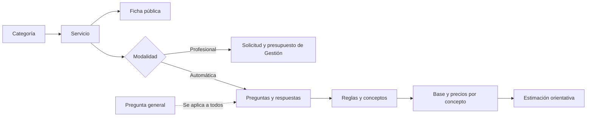

# Guía para cargar y configurar servicios

**Actualizado:** 27 de noviembre de 2026

**Alcance:** procedimiento de Administración y comportamiento real del catálogo y el estimador en synaux.

## Resumen del modelo

Un servicio tiene una categoría, una ficha comercial y una modalidad de cotización. Si se calcula automáticamente, puede tener preguntas, opciones, conceptos de precio, reglas y valores dentro de un tarifario versionado.

La respuesta del estimador se valida y calcula en el servidor. Las respuestas, conceptos e importes calculados se guardan como una instantánea de la estimación. El navegador no decide el precio.

## Procedimiento de alta

### 1. Crear o confirmar la categoría

En **Administración → Categorías**, completar:

- **Nombre:** especialidad que agrupa los servicios.
- **Identificador:** se genera a partir del nombre; queda en la dirección y debe ser único.
- **Descripción.**
- **Activa:** las categorías inactivas no muestran sus servicios en la oferta pública.

No se puede eliminar una categoría que todavía tenga servicios. Se puede desactivar para dejar de ofrecerla y conservar sus datos.

### 2. Crear la ficha del servicio

En **Administración → Servicios → Nuevo servicio**, completar:

- **Nombre del servicio.**
- **Categoría existente.**
- **Descripción breve:** resumen para listados y tarjetas.
- **Dirección del servicio:** identificador legible generado desde el nombre; puede ajustarse con letras, números y guiones, y debe ser único.
- **Descripción completa:** objetivo, alcance y límites.
- **Entregables:** uno por línea; se muestran en la ficha pública.
- **Modalidad de estimación:**
  - **Cotización profesional:** el cliente explica lo que necesita y Gestión define el importe en un presupuesto formal.
  - **Estimación automática:** el resultado depende de una base tarifaria y, cuando corresponda, de respuestas y componentes configurados.
- **Mostrar en el catálogo:** los servicios nuevos empiezan desactivados; conviene publicarlos después de revisar preguntas y precios.

Guardar la ficha conduce a la configuración de preguntas. La ficha puede guardarse antes de tener precios. Si se activa un servicio automático sin cobertura suficiente, la oferta puede mostrarse, pero el estimador lo deriva a revisión profesional en vez de dar un precio automático.

### 3. Configurar preguntas

En la pestaña **Preguntas**, elegir entre una pregunta propia del servicio o una pregunta general reutilizable en todos los servicios.

Cada pregunta incluye:

- Texto de la pregunta.
- Tipo de respuesta: **una opción**, **varias opciones**, **cantidad** o **texto libre**.
- Orden de aparición, obligatoriedad y estado activo.
- Para preguntas de opción, una respuesta por línea.
- Para una pregunta numérica propia del servicio, se puede vincular la cantidad a un concepto de precio.

Las preguntas de opción activan reglas. Las preguntas generales no deben controlar un concepto exclusivo de un servicio. Desactivar una pregunta conserva el historial. Al editar sus opciones, las que se mantienen conservan su identidad; al cambiar un texto, hay que revisar las reglas asociadas.

### 4. Definir conceptos y reglas

En la pestaña **Estimación**:

- Crear un **concepto** por unidad de trabajo que pueda variar el precio, por ejemplo, una sección adicional o una asistencia.
- Definir nombre, identificador único dentro del servicio, descripción y unidad.
- Marcarlo **incluido por defecto** si forma parte de todas las estimaciones; indicar la cantidad inicial.
- Si depende de una respuesta, crear una **regla** que vincule la opción con el concepto y la cantidad que suma.
- Para una cantidad escrita por el cliente, vincular la pregunta numérica con el concepto correspondiente.
- Comprobar que cada regla conecte una opción y un concepto del mismo servicio. No dejar conceptos activos sin una razón: se muestran como incluidos, condicionales o pendientes de configuración.

La aplicación permite copiar una pregunta o concepto de otro servicio como plantilla. La copia queda asociada al servicio nuevo, pero sus reglas y precios deben configurarse aparte.

### 5. Cargar precios

En **Administración → Tarifarios → Nueva versión**, se ingresan precios propios en USD y la cotización CCL de venta que se usará para mostrar el equivalente en ARS. La cotización se guarda con fecha y hora dentro de esa versión; no se consulta ni actualiza automáticamente.

Para cada servicio automático, cargar un importe para **Particular**, **PyME** y **Empresa**. Si el precio cambia según el alcance, completar un mínimo y un máximo; para un precio fijo, repetir el mismo importe. Los conceptos adicionales se cargan aparte en USD y se suman cuando las respuestas o cantidades del servicio los activan.

Cada publicación crea una versión nueva y conserva las anteriores. Al copiar una versión en USD, se copian sus importes como punto de partida. Las tarifas históricas en ARS no se reinterpretan como USD; hay que ingresar los importes propios en la nueva versión. El equivalente en pesos que se muestra junto a cada campo se calcula con el CCL guardado en esa versión.

Antes de activar un tarifario, el servidor exige el precio de cada variante para cada servicio automático activo y un importe para cada concepto activo. El precio máximo no puede ser menor que el mínimo.

### 6. Publicar y revisar

- Activar la categoría y el servicio.
- Para un servicio automático, verificar que la tarifa vigente tenga cobertura completa.
- Comprobar que las preguntas requeridas sean claras, que cada opción relevante active la regla esperada y que el concepto tenga precio.
- Revisar la ficha y hacer un cálculo completo en la plataforma. Confirmar que un caso fijo o variable muestre el importe esperado.
- Si se quiere mostrar en Inicio, seleccionar el servicio desde **Servicios destacados**. Se permiten hasta tres servicios activos de categorías activas.

Si falta configuración necesaria para calcular, el sistema deriva el caso a revisión profesional en lugar de inventar un importe. En modalidad profesional, la tarjeta indica que el presupuesto se prepara después de revisar la solicitud.

## Cómo se guarda y se usa

| Dato | Cómo se relaciona |
| --- | --- |
| Categoría | Cada servicio pertenece a una categoría. |
| Pregunta | Pertenece a un servicio o tiene alcance general si no está asociada a uno. |
| Opción | Pertenece a una pregunta. Las opciones activas aparecen al cliente. |
| Concepto | Pertenece a un servicio y puede ser fijo por defecto, condicional o cuantificado por una respuesta numérica. |
| Regla | Vincula una opción con un concepto y la cantidad que agrega al cálculo. |
| Precio por variante | Importe mínimo y máximo por servicio y tipo de cliente dentro de una versión del tarifario. |
| CCL | Cotización manual guardada en la versión para convertir referencias USD a ARS sin alterar estimaciones previas. |
| Concepto | Precio adicional por unidad dentro de la versión; se suma cuando lo indican las respuestas del servicio. |
| Estimación | Guarda las respuestas, los conceptos y los importes como instantánea para conservar lo calculado. |

La oferta pública consulta servicios y categorías activos. El estimador carga preguntas activas del servicio y preguntas generales; después valida respuestas, aplica reglas y consulta la tarifa vigente en el servidor. Las solicitudes y los presupuestos profesionales siguen su propio recorrido.

Al editar o eliminar:

- Desactivar conserva referencias históricas y deja de ofrecer el registro nuevo.
- Eliminar un servicio o categoría solo se permite si no tiene vínculos con registros existentes.
- Los cambios de tarifario no modifican estimaciones o presupuestos ya guardados.
- El catálogo puede priorizar USD o ARS; cuando hay CCL guardado, también muestra el importe equivalente en la otra moneda.

## Servicios activos en la base local al 27/11/2026

Este inventario refleja la base local consultada ese día; puede diferir de otra instalación. Los conteos son preguntas propias activas y conceptos activos. Las preguntas generales se comparten y no se repiten en la tabla.

| Servicio | Modalidad guardada | Preguntas propias activas | Conceptos activos | Nota de configuración observada |
| --- | --- | ---: | ---: | --- |
| Desarrollo Sitio Web Corporativo / Institucional | Automática | 2 | 1 | Tiene respuestas de secciones y contenido; el precio varía por segmento de cliente. |
| Identidad visual | Profesional | 1 | 0 | Solicita objetivo y necesidad mediante texto. |
| Campaña digital | Profesional | 1 | 0 | Solicita objetivo y necesidad mediante texto. |
| Diseño y Desarrollo de Landing Page Optimizada | Automática | 1 | 1 | Pregunta segmento de cliente y aplica el concepto de adecuación. |
| Tienda online | Automática | 1 | 0 | Tiene precio base y una pregunta de texto; esa respuesta no modifica el importe. |
| Diseño UX/UI | Profesional | 1 | 0 | Solicita objetivo y necesidad mediante texto. |
| Piezas para redes sociales | Profesional | 1 | 0 | Solicita objetivo y necesidad mediante texto. |
| Auditoría SEO | Profesional | 1 | 0 | Solicita objetivo y necesidad mediante texto. |
| Estrategia de contenidos | Profesional | 1 | 0 | Solicita objetivo y necesidad mediante texto. |
| Auditoría de usabilidad | Profesional | 1 | 0 | Solicita objetivo y necesidad mediante texto. |
| Prototipo interactivo | Profesional | 1 | 0 | Solicita objetivo y necesidad mediante texto. |
| prueba | Automática | 0 | 0 | Está activo y tiene precio base, pero no presenta preguntas propias ni conceptos. Confirmar si debe seguir publicado. |
| Desarrollo Aplicación Web a Medida (MVP) | Profesional | 0 | 0 | No tiene pregunta propia activa en la base local. |
| LiliTech | Automática | 0 | 1 | Tiene precio base y un concepto activo por defecto, pero no presenta pregunta propia activa. |

El inventario sirve para revisar la instalación local; no reemplaza la ficha del servicio ni sus tarifas. Antes de copiarlo a producción, contrastarlo con la base de esa instalación y decidir si registros como **prueba** y **LiliTech** deben permanecer como servicios públicos.

## Archivos principales del código

- Pantalla y ficha de alta: `resources/js/Screens/Admin/CatalogList.vue` y `resources/js/Screens/Admin/ServiceEditor.vue`.
- Preguntas, conceptos, reglas y precios vigentes del servicio: `resources/js/Components/Admin/ServiceConfiguration.vue`.
- Carga versionada de precios y CCL: `resources/js/Screens/Admin/Tariffs.vue` y `app/Http/Controllers/Admin/TariffController.php`.
- Validación y guardado del catálogo: `app/Http/Controllers/Admin/CatalogConfigurationController.php`.
- Publicación de tarifarios: `app/Http/Controllers/Admin/TariffController.php`.
- Lectura del catálogo y cálculo del estimador: `app/Services/Catalog/ServiceCatalog.php`.
- Datos iniciales: `database/seeders/SynauxCatalogSeeder.php` y seeders específicos de tarifas.

La carga habitual se hace desde Administración y queda en la base de datos. Los seeders solo preparan contenido inicial repetible para una instalación; no son el formulario de carga ni necesariamente contienen los cambios hechos después desde el panel. La pregunta global de tipo de cliente es compartida por los servicios y sus opciones determinan qué renglón del tarifario se usa.

## Documentación relacionada

- [Roles y capacidades](roles-y-capacidades.md): quién tiene permiso para cargar esta configuración.
- [Reglas del ciclo de proyecto](reglas-del-ciclo-de-proyecto.md): qué ocurre tras enviar una solicitud y aceptar el presupuesto.
