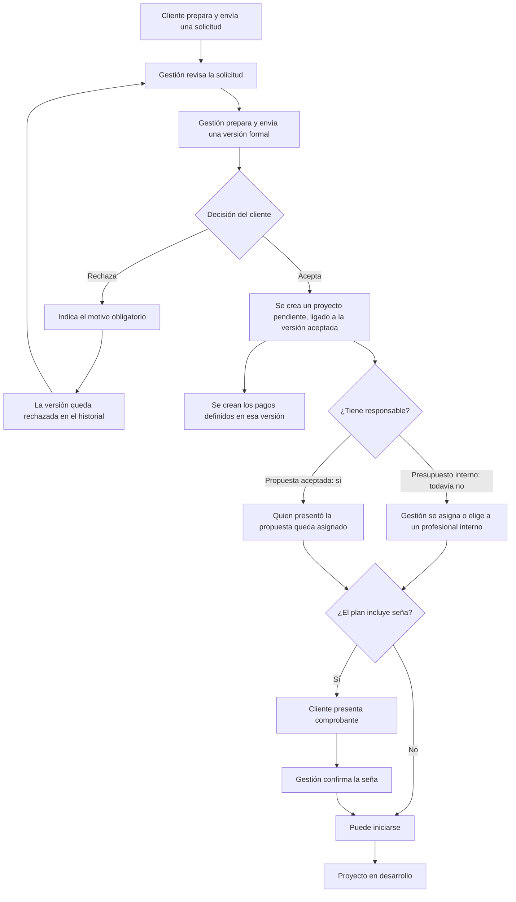
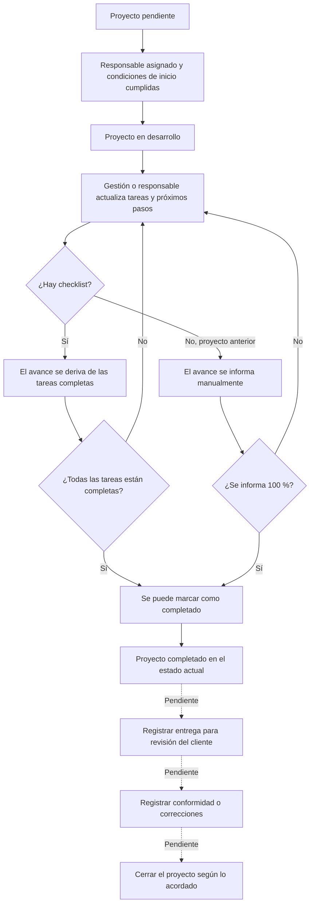

# Reglas del ciclo de proyecto

**Actualizado:** 27 de noviembre de 2026

**Propósito:** mantener en un solo lugar las reglas acordadas para pasar de una estimación al cierre de un proyecto.

Los diagramas describen el recorrido funcional. La tabla distingue lo que ya hace la aplicación de lo que queda por completar. Cuando cambie una regla, actualizar primero esta referencia junto con la implementación correspondiente.

## Estados

- **Implementado:** la aplicación aplica la regla en el recorrido actual.
- **Parcial:** existe una parte del recorrido, pero falta completar el comportamiento acordado.
- **Pendiente:** todavía debe diseñarse o implementarse.

## Reglas acordadas y estado actual

| Etapa | Regla | Estado |
| --- | --- | --- |
| Estimación y solicitud | El cliente prepara una estimación y la envía a Gestión como solicitud. La estimación orientativa y el presupuesto formal son documentos y pasos distintos. | Implementado |
| Revisión | Gestión revisa la solicitud antes de preparar el presupuesto formal. | Implementado |
| Versiones de presupuesto | Cada versión conserva sus propios importes y condiciones. Solo la versión vigente enviada puede aceptarse. | Implementado |
| Rechazo | El cliente debe indicar el motivo. La versión queda rechazada y el motivo se conserva para consulta. | Implementado |
| Aceptación | Aceptar la versión vigente cierra la solicitud de origen y crea un único proyecto vinculado a esa versión aceptada. | Implementado |
| Pagos | El proyecto conserva el plan de pago de la versión aceptada. El cliente puede presentar comprobantes y Gestión puede confirmarlos u observarlos. | Implementado |
| Responsable interno | Los presupuestos de Gestión crean el proyecto pendiente. Gestión asigna al responsable de ejecución; puede asignárselo a sí misma o elegir a un profesional interno activo. | Implementado |
| Propuesta aceptada | Si el presupuesto proviene de una propuesta aceptada, quien la presentó queda registrado como responsable inicial. | Implementado |
| Inicio | El proyecto no puede pasar a «En desarrollo» si falta responsable. Si el plan incluye seña, Gestión debe confirmarla antes del inicio. | Implementado |
| Checklist y avance | Cuando hay tareas, el porcentaje se calcula según las tareas completadas. Un proyecto con tareas incompletas no puede marcarse como completado. | Implementado |
| Proyectos anteriores sin tareas | Conservan la actualización manual del avance; pendiente corresponde a 0 % y completado a 100 %. | Implementado |
| Comunicación al cliente | Las notas de avance y los próximos pasos registrados en el seguimiento son visibles para el cliente. | Implementado |
| Notas internas | Separar las notas internas de Gestión de las actualizaciones visibles para el cliente. | Pendiente |
| Entrega y revisión | Registrar una entrega formal, permitir que el cliente la revise y ordenar el cierre según las condiciones acordadas. | Pendiente |

## Recorrido desde la estimación hasta el inicio

### Detalles del plan de pago

- El plan y las fechas o hitos se acuerdan en el presupuesto y quedan asociados a su versión.
- Si existe seña, el comprobante enviado no equivale a pago confirmado: Gestión debe revisarlo.
- El proyecto permanece pendiente hasta tener responsable y hasta confirmar la seña, cuando corresponda.
- El importe de la seña y el reparto del saldo deben leerse desde la versión aceptada; no recalcular ni cambiar las condiciones de un presupuesto aceptado.

## Seguimiento y cierre

La finalización técnica actual es el estado **Completado**. La entrega formal al cliente, su revisión y la conformidad todavía no forman un flujo integrado; no deben darse por hechas al marcar el proyecto como completado.

## Cómo mantener este documento

1. Al acordar una regla nueva o cambiar una existente, actualizar la fila correspondiente y los diagramas afectados.
2. Marcarla como **Pendiente** hasta que esté implementada; luego pasarla a **Implementado** o **Parcial** según corresponda.
3. Registrar la fecha de actualización y el cambio de código relacionado en el historial de Git.
4. No presentar una regla pendiente como una capacidad ya disponible en la aplicación.

## Documentación relacionada

- [Roles y capacidades](roles-y-capacidades.md): acceso de Administración, Gestión, profesionales internos y clientes.
