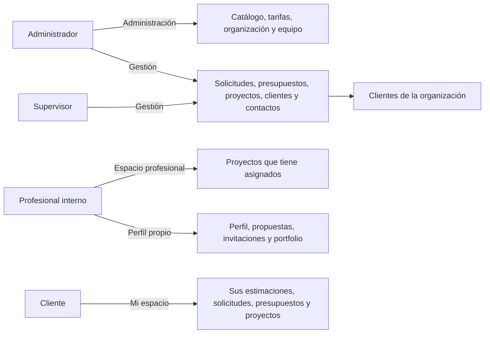

# Roles y capacidades en synaux

**Actualizado:** 27 de noviembre de 2026

**Alcance:** permisos que existen hoy para la organización principal de synaux. Esta referencia describe el comportamiento real de las rutas y validaciones, no permisos futuros.

## Vista rápida

El administrador reúne dos ámbitos: **Administración** y **Gestión**. El supervisor tiene acceso a Gestión, pero no a las opciones de configuración reservadas a Administración. El profesional interno ve los proyectos que tiene asignados y trabaja con su propio perfil. El cliente consulta sus propios registros.

## Matriz de permisos

| Capacidad | Administrador | Supervisor | Profesional interno | Cliente |
| --- | --- | --- | --- | --- |
| Editar servicios y categorías del catálogo | Sí | No | No | No |
| Editar preguntas, opciones, componentes y reglas de estimación | Sí | No | No | No |
| Publicar versiones de tarifas y destacar servicios | Sí | No | No | No |
| Editar datos de emisión y dominio del correo del equipo | Sí | No | No | No |
| Administrar miembros y roles del equipo | Sí | No | No | No |
| Revisar solicitudes y preparar presupuestos | Sí | Sí | No | No |
| Consultar cartera de clientes de synaux | Sí | Sí | No | No |
| Gestionar proyectos y asignar responsables | Sí | Sí | No | No |
| Actualizar tareas de un proyecto asignado | Sí | Sí | Sí, en sus proyectos | No |
| Revisar comprobantes de pago | Sí | Sí | No | No |
| Presentar comprobante de un pago propio | No | No | No | Sí |
| Administrar trabajos del portfolio de synaux | Sí | Sí | No | No |
| Gestionar consultas de contacto | Sí | Sí | No | No |
| Ver o modificar los datos propios y la contraseña | Sí | Sí | Sí | Sí |

El acceso a cada registro privado se filtra por propiedad, emisión, membresía o asignación; tener el rol de administrador no quita esas comprobaciones.

## Qué puede hacer el administrador

### 1. Configurar el catálogo y el estimador

Desde **Administración** puede:

- Crear, editar, activar o desactivar servicios y categorías.
- Configurar las preguntas del estimador, sus opciones, componentes y reglas de cálculo.
- Seleccionar hasta tres servicios destacados en Inicio.
- Eliminar un servicio o categoría solo cuando no tiene información asociada. El sistema impide borrar servicios usados por estimaciones, solicitudes, presupuestos, tarifas, perfiles, portfolio, componentes, preguntas, opciones o destacados; también impide borrar categorías que todavía tienen servicios.

### 2. Mantener los precios

- Crear versiones del tarifario en ARS, USD o EUR, con rangos para servicios y componentes.
- Ajustar el precio de un servicio publicando una versión nueva.
- Conservar los importes históricos: una nueva tarifa no reescribe los cálculos o presupuestos anteriores.
- Activar una tarifa solo cuando están completos los importes requeridos por los servicios automáticos activos.

### 3. Administrar la organización

- Actualizar razón social, CUIT, correo, teléfono y domicilio usados como datos de emisión.
- Configurar el dominio de correo permitido para las cuentas del equipo.
- Los presupuestos emitidos conservan su propia copia de los datos de emisión.

### 4. Administrar el equipo

- Crear cuentas de equipo con nombre, correo corporativo y uno de estos roles: administrador, supervisor o profesional.
- Compartir un enlace de activación de un solo uso que vence a las 48 horas. Si se genera otro, el anterior deja de servir.
- Cambiar el rol de un miembro existente o quitarlo del equipo. El correo no se cambia desde la acción de rol.
- Consultar el listado del equipo por separado de la cartera de clientes.

La persona recibe una cuenta pendiente de activación; el administrador no define ni conoce su contraseña personal. El cliente no se agrega al equipo ni recibe un rol interno.

### 5. Usar Gestión

Además de Administración, el administrador puede:

- Revisar y cerrar solicitudes.
- Preparar y emitir presupuestos, y consultar sus versiones.
- Consultar clientes vinculados a la organización.
- Asignar responsables internos y dar seguimiento a proyectos.
- Mantener el portfolio y revisar consultas recibidas.
- Confirmar u observar comprobantes de pago.

## Límites y separación de responsabilidades

- **Gestión** es el trabajo diario. **Administración** cambia la configuración del negocio y del equipo.
- Un supervisor puede gestionar solicitudes, presupuestos y proyectos, pero no editar catálogo, tarifas, datos de emisión ni roles del equipo.
- Los clientes están en la cartera de **Gestión**, no en la lista de miembros de **Administración**.
- El profesional interno no puede asignarse proyectos ni consultar proyectos de otros: su acceso se limita a los que tiene asignados.
- Cada cuenta edita sus propios datos personales y contraseña. Los datos de synaux como empresa se editan en **Administración → Datos de la organización**.
- La aplicación actual opera sobre la organización principal de synaux. La configuración aislada para empresas externas es una ampliación futura, no una capacidad que se deba dar por disponible.

## Documentación relacionada

- [Guía de carga de servicios](guia-carga-de-servicios.md): procedimiento, campos y configuración del estimador.
- [Reglas del ciclo de proyecto](reglas-del-ciclo-de-proyecto.md): aceptación, pagos, asignación, inicio, checklist y cierre.
